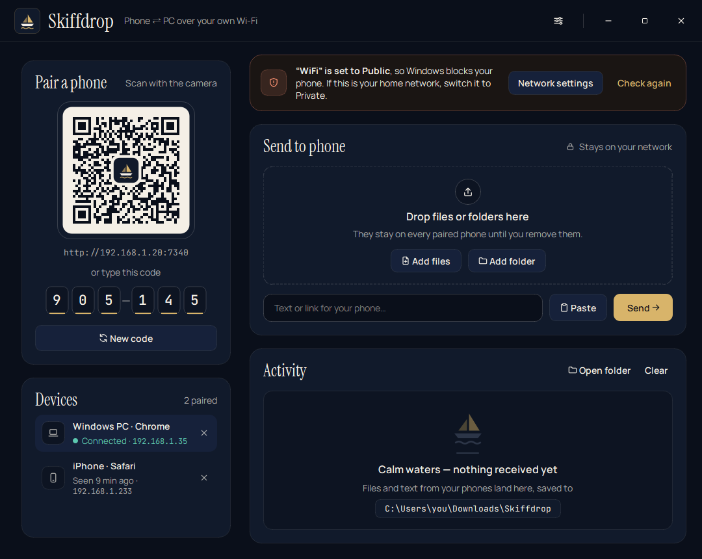
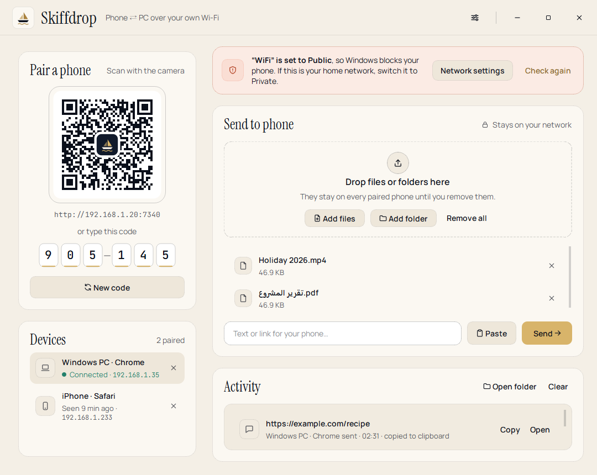
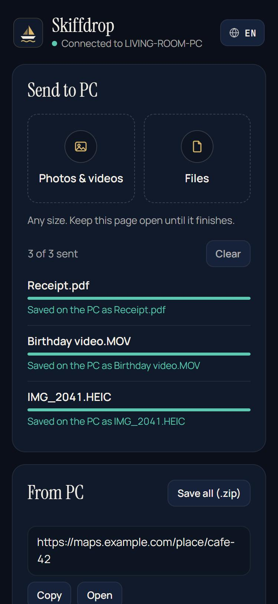
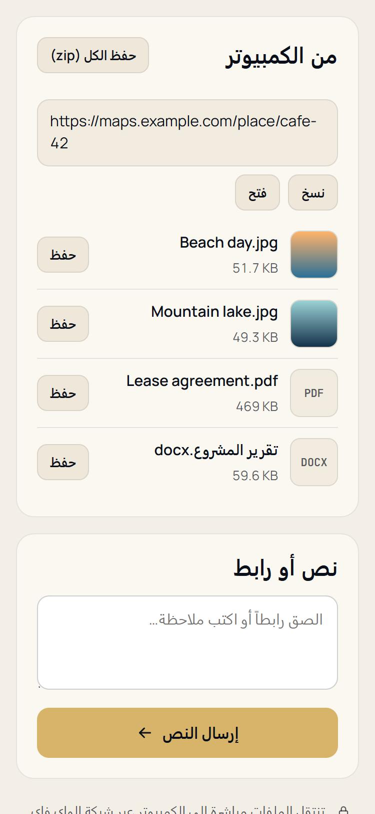

# Skiffdrop

**Send files between your phone and your Windows PC over Wi-Fi. Scan a QR code and you're done: nothing to install on the phone, no account, no cloud.**

Stop mailing photos to yourself or dropping them in a WhatsApp or Discord chat just to get them onto your PC. Skiffdrop runs a small web server on your PC that only your home network can reach. Your phone opens it in Safari or Chrome, and files go straight from one device to the other.

<p align="center">
  
</p>
<p align="center">
  
</p>
<p align="center">
  
  &nbsp;&nbsp;
  
</p>

## What it does

- **iPhone → PC** and **Android → PC**: photos, videos or any file, many at once and of any size, with a progress bar and the speed.
- **PC → phone**: drag files or whole folders onto the window (or right-click a file → *Send to* → *Skiffdrop (to phone)*). They show up on the phone with a *Save* button, picture previews and *Save all (.zip)*.
- **Text and links** both ways. Text from the phone goes straight to the PC's clipboard.
- **Nothing to install on the phone.** It's a web page served by your PC, so iPhone, iPad, Android and other computers all work.
- **Big files are fine.** Uploads go in 16 MB pieces, and a lost connection picks up where it stopped. The PC writes every piece straight to disk, so a 4 GB video doesn't use 4 GB of memory.
- **Six languages** on the PC and on the phone: English, العربية, Español, Français, 日本語 and 中文（简体）. Each follows the device's language and can be changed (Arabic runs right to left).
- **Dark and light**, following Windows and the phone. You can also pick one in Settings.
- A tray icon keeps it running in the background, and it can start with Windows if you want.

The look is **Harbor Edition**: Harbor Ink and Sail Ivory grounds, brass for the one action that matters, Instrument Serif titles, Manrope text and JetBrains Mono for codes and addresses. The fonts ship with the app, so nothing is fetched from the internet. Arabic, Japanese and Chinese use the device's own font for their script.

## Install (Windows 10/11)

1. Download **`Skiffdrop-Setup-1.0.0.exe`** from [Releases](https://github.com/Niro54321/Skiffdrop/releases/latest). It installs just for you, with no admin prompt.
2. The installer isn't code-signed, so Windows SmartScreen may warn you. Click **More info → Run anyway**. You can check the download against the `.sha256` file next to it:
   ```powershell
   Get-FileHash .\Skiffdrop-Setup-1.0.0.exe -Algorithm SHA256
   ```
3. **One-time network setup.** Your phone has to be able to reach the PC:
   - Your Wi-Fi must be a **Private** network in Windows (*Settings → Network & internet → Wi-Fi → your network → Private network*). Windows blocks devices on networks marked *Public*. Skiffdrop shows a yellow bar with a shortcut if yours is Public.
   - Click **Allow…** in that bar once. After one admin prompt it adds a firewall rule for Skiffdrop on **private networks only** (TCP port 7340). It never opens anything on public networks.

## Use it from an iPhone

1. Connect the iPhone and the PC to the **same Wi-Fi**.
2. Open the **Camera** app, point it at the QR code in Skiffdrop and tap the yellow link. Safari opens the Skiffdrop page.
3. On the PC, click **Allow** on the small card that pops up at the bottom right. You only do this once per phone.
4. **To send to the PC**: tap *Photos & videos* or *Files* and pick as many as you like. Files land in `Downloads\Skiffdrop` on the PC.
5. **To get files from the PC**: drop them on the Skiffdrop window. On the iPhone:
   - Photo: tap it, press and hold, then tap **Save to Photos**.
   - Video or other file: tap **Save**, which puts it in *Files → Downloads*. For a video, open it there, tap Share, then **Save Video**.
6. Tip: tap Share → **Add to Home Screen** in Safari. Next time you open it from there, it reconnects without scanning, as long as the PC keeps the same address on your Wi-Fi.

> Keep the page open while big files are sending. If the screen locks, iOS pauses Safari, and the transfer carries on when you come back.
>
> When you pick from *Photos & videos*, iOS may convert HEIC photos and HEVC videos to JPEG and H.264 before Safari gets them.

## Use it from an Android phone

1. Connect the phone and the PC to the **same Wi-Fi**.
2. Scan the QR code with the camera (or Google Lens) and open the link in Chrome.
3. Click **Allow** on the PC.
4. **To send to the PC**: tap *Photos & videos* or *Files*.
5. **To get files from the PC**: tap **Save** next to a file. It goes to the phone's *Downloads* folder. Photos and videos also show up in the gallery, usually under *Download*.

No camera? Type the address shown under the QR code (for example `http://192.168.1.20:7340`) into the phone's browser, then enter the 6-digit code.

## Security

Skiffdrop is built for a home or office Wi-Fi you trust:

| | |
|---|---|
| **Local network only** | The server refuses any address that isn't private (192.168.x, 10.x, 172.16–31.x, link-local). It never talks to the internet: no cloud, no relay, no telemetry, no account. |
| **QR key + your OK** | The QR code holds a random key that changes every time Skiffdrop starts (or when you click *New code*). Even with the key, every new device has to be approved on the PC. *Phones* lists the devices you allowed, and **✕** removes one. |
| **Optional PIN** | In Settings you can add a 4–12 digit PIN that a phone must type before you're even asked. |
| **Guessing is cut off** | After 5 wrong codes or PINs from one address, that address is locked out for a minute, then for longer each time. After 30 wrong tries in total the code changes by itself. |
| **No tricks from web pages** | The Host header must be an IP address, which stops DNS-rebinding. The device cookie is `HttpOnly` and `SameSite=Strict`, and requests that change anything need a custom header, so other web sites can't use your browser to reach Skiffdrop. Shared files are served with a sandbox CSP. |
| **Safe file names** | Names from the phone are cleaned before saving: no folders, no `..`, no reserved Windows names, no hidden right-to-left tricks. Files are only ever written inside your save folder, and an existing file is never overwritten (you get `name (1).jpg`). |
| **Firewall: private only** | The firewall rule is limited to private networks and to Skiffdrop's own program and port. |

**What it does not do:** the connection is plain HTTP inside your network, like most local devices (printers, routers, smart TVs). A browser treats a home-network address as "not secure" no matter what, and a self-signed HTTPS certificate would show a scary warning on every phone. So use it on your own Wi-Fi, not on hotel or café Wi-Fi.

## Measured speed

Measured on the developer's PC (Windows 11, 192.168.x Wi-Fi address). The "phone" was Chrome on the same PC with mobile emulation, plus a small client that uses the page's exact protocol for the 2 GB upload. Every file was checked byte for byte with CRC-32.

| Test | Result |
|---|---|
| 32 files at once (a 100 MB video, a 3 MB photo, 30 photos of 512 KB, Arabic names), phone → PC | 0.55 s in total (≈ 227 MB/s) |
| 54 small files at once (1 KB to 200 KB, Arabic and emoji names), phone → PC | all saved and checked |
| 100 MB, phone → PC | 0.41 s (≈ 250 MB/s) |
| 2.25 GB, phone → PC | 7.8 s (≈ 287 MB/s); the server process stayed at ~94 MB of memory |
| 2.25 GB, PC → phone (browser download) | 5.2–5.6 s (≈ 400–436 MB/s) |
| *Save all* zip with the 2.25 GB file inside (2.36 GB) | 5.0 s (≈ 470 MB/s), zip64 checked |

These numbers show the app's own overhead, because the traffic never left the PC. **Over real Wi-Fi your router sets the speed**: roughly 10–40 MB/s on Wi-Fi 5 and 30–100 MB/s on Wi-Fi 6, with both devices close to the router.

## Build from source

```powershell
py -3.11 -m venv .venv
.venv\Scripts\python -m pip install -e .[dev]
.venv\Scripts\python -m skiffdrop          # run it
.venv\Scripts\python -m pytest tests       # protocol, security and file-name tests
.venv\Scripts\python packaging\build.py    # PyInstaller + self-test + Inno Setup installer
```

The installer needs [Inno Setup 6](https://jrsoftware.org/isinfo.php) (`winget install JRSoftware.InnoSetup`).

Layout: `skiffdrop/server.py` (HTTP server, pairing, uploads/downloads), `skiffdrop/web/` (the phone page, with no libraries, and its `i18n.js`), `skiffdrop/app.py` + `ui.py` + `theme.py` + `i18n.py` (the PySide6 window, tray, palettes and translations), `skiffdrop/netutil.py` (network address, firewall rule), `packaging/` (installer).

## How is this different from LocalSend?

[LocalSend](https://github.com/localsend/localsend) is great and needs its app on both devices. Skiffdrop needs nothing on the phone: you scan a code and use the browser you already have. That suits a friend's phone, a work phone where you can't install apps, or an iPhone without an App Store account.

## Uninstall

*Settings → Apps → Skiffdrop → Uninstall.* This removes the app and its settings (`%APPDATA%\Skiffdrop`). Files you received stay in `Downloads\Skiffdrop`. To remove the firewall rule too, run in an admin terminal:

```powershell
netsh advfirewall firewall delete rule name="Skiffdrop"
```

## License

[MIT](LICENSE) © 2026 Niro54321. The installer also contains Python, Qt 6 / PySide6 (LGPL-3.0) and segno (BSD). The fonts Instrument Serif, Manrope and JetBrains Mono are under the SIL Open Font License 1.1, with their licence files in `skiffdrop/web/fonts`. See `THIRD-PARTY-NOTICES.txt` in the install folder.
